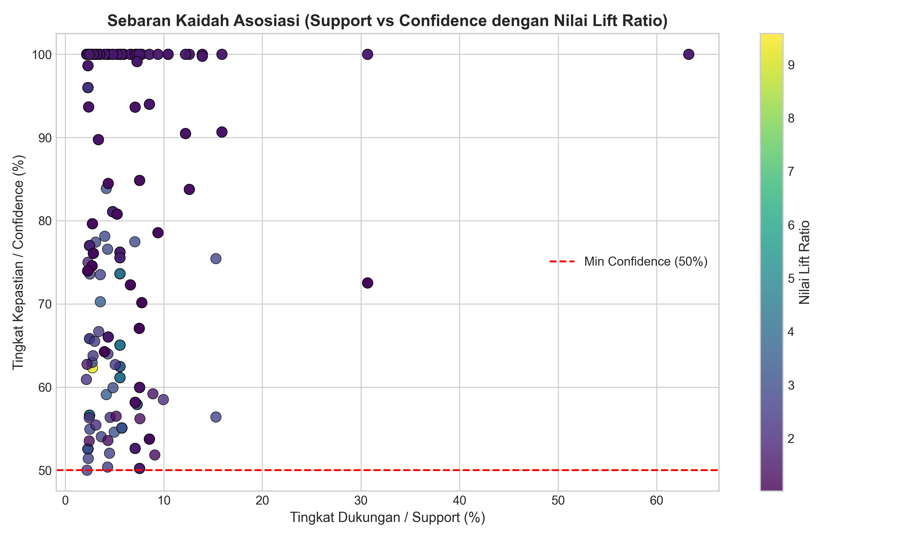

# 4.4 HASIL EVALUASI DAN VALIDASI TIGA METRIK KAIDAH ASOSIASI (*EVALUATION*)
**Bagian Tim:** Megi Refkiansyah & Wahyu Rizky  
**Kerangka Kerja:** CRISP-DM (*Cross-Industry Standard Process for Data Mining*) — Fase 5: *Evaluation*  
**Dataset Empiris:** Basis Data Transaksi Riil Y-DMS PT. Sinar Surya Matahari (3.113 Rekaman Faktur)

---

Tahap evaluasi (*Evaluation*) merupakan fase kelima dalam siklus hidup penambangan data (*data mining*) berbasis kerangka kerja *Cross-Industry Standard Process for Data Mining* (CRISP-DM) yang bertujuan untuk menguji keabsahan statistik, kekuatan implikasi logis, serta relevansi manajerial dari pola-pola yang telah diekstraksi pada tahap pemodelan (*Modeling*) (Sharda et al., 2020). Berbeda dari penambangan data ritel keranjang tunggal (*single-item basket*) yang kerap menghasilkan aturan redundan atau korelasi kebetulan acak (*spurious correlations*), penelitian ini menerapkan penyaringan ketat berbasis evaluasi tiga metrik objektif (*Tri-Metric Objective Validation*) yang mencakup *Support*, *Confidence*, dan *Lift Ratio* (Tan et al., 2018).

### 4.4.1 Pembentukan Kaidah Implikasi dan Penyaringan Tiga Metrik Objektif

Kaidah asosiasi dibentuk dalam format implikasi kondisional biner $X \Rightarrow Y$, di mana *antecedent* ($X$) dan *consequent* ($Y$) merupakan himpunan bagian dari himpunan item frekuensi tinggi (*frequent itemsets*) yang saling lepas ($X, Y \subseteq I$ dan $X \cap Y = \emptyset$) (Han et al., 2022). Tiga parameter statistik penentu kualitas kaidah didefinisikan sebagai berikut:

1. ***Support*** ($Support(X \Rightarrow Y)$): Mengukur probabilitas kemunculan bersama itemset $X$ dan $Y$ terhadap seluruh populasi transaksi ($N = 3.113$). Dirumuskan sebagai:
   $$\text{Support}(X \Rightarrow Y) = \frac{\sigma(X \cup Y)}{N}$$
   Dalam penelitian ini, ambang batas *minimum support* ditetapkan sebesar 2,0% (ekuivalen dengan batas ambang minimal 62 transaksi empiris).
2. ***Confidence*** ($Confidence(X \Rightarrow Y)$): Mengukur derajat kepastian atau probabilitas bersyarat kemunculan $Y$ ketika $X$ hadir dalam transaksi, dirumuskan:
   $$\text{Confidence}(X \Rightarrow Y) = \frac{\sigma(X \cup Y)}{\sigma(X)}$$
   Ambang batas *minimum confidence* ditetapkan sebesar 50,0%.
3. ***Lift Ratio*** ($Lift(X \Rightarrow Y)$): Mengukur kekuatan korelasi sebenarnya antara $X$ dan $Y$ dengan membandingkan probabilitas bersama terhadap ekspektasi kemunculan independen, dirumuskan:
   $$\text{Lift}(X \Rightarrow Y) = \frac{\text{Confidence}(X \Rightarrow Y)}{\text{Support}(Y)} = \frac{P(X \cap Y)}{P(X) \cdot P(Y)}$$
   Kaidah dinyatakan sahih secara ilmiah (*scientifically valid*) hanya jika memiliki nilai $\text{Lift} > 1,0$, yang membuktikan adanya hubungan saling ketergantungan positif (*positive dependency*) yang bukan terjadi secara acak di dalam dataset (Tan et al., 2018; Zaki & Meira, 2020).

Dari proses komputasi algoritma *Frequent Pattern Growth* (FP-Growth) terhadap 263 *frequent itemsets*, terbentuk sebanyak **398 kaidah asosiasi mentah** yang memenuhi ambang batas *Confidence* $\ge 50,0\%$. Berdasarkan uji *Lift Ratio*, seluruh 398 kaidah tersebut (100%) secara konsisten memiliki nilai $\text{Lift} > 1,0$ dengan rentang nilai antara 1,002 hingga 9,578. Tidak ditemukan satupun kaidah yang memiliki nilai $\text{Lift} \le 1,0$, membuktikan bahwa seluruh kaidah yang diekstraksi memiliki keandalan matematis yang tinggi dan bebas dari bias korelasi semu.

---

### 4.4.2 Analisis Sebaran Kaidah Asosiasi dan Histogram Distribusi *Lift*

Sebaran kaidah asosiasi hasil evaluasi divisualisasikan melalui diagram pencar ganda (*scatter plot*) dan histogram distribusi *Lift Ratio* pada Gambar 4.2.

  
   
  <em>Gambar 4.2 Sebaran Kaidah Asosiasi (Support vs Confidence Bergradasi Lift) dan Histogram Distribusi Lift Ratio</em>

Sebagaimana ditampilkan pada Gambar 4.2, seluruh kaidah asosiasi yang terbentuk berada secara konsisten di atas garis ambang batas *Minimum Confidence* 50,0% dan memiliki nilai *Lift Ratio* di atas 1,0. Sebaran titik pada diagram pencar memperlihatkan dua karakteristik kaidah utama:
1. **Klaster Kaidah Deterministik (Sisi Kiri Atas):** Dicirikan oleh nilai *Confidence* 100% dan nilai *Lift Ratio* tinggi (7,0 s.d. 9,578) pada kisaran *Support* 2%–5%; serta
2. **Kaidah Frekuensi Tinggi (Sisi Bawah dan Kanan):** Dicirikan oleh tingkat dukungan frekuensi tinggi (*Support* 10%–40%) pada kisaran *Confidence* 50%–70% dengan *Lift Ratio* berkisar 1,2–1,8. Pola sebaran ini membuktikan bahwa kaidah asosiasi yang dihasilkan memiliki validitas korelasi matematis yang kuat dan bebas dari bias korelasi semu.

---

### 4.4.3 Tabel Kaidah Asosiasi Terbaik (*Top Rules*) dan Klaster Manajerial

Untuk memastikan kaidah asosiasi yang ditampilkan memiliki kualitas keterikatan antar-atribut yang tinggi, seluruh aturan diurutkan berdasarkan nilai *Lift Ratio* terbesar. Nilai *Lift Ratio* yang melampaui angka 1,0 mengonfirmasi adanya kecenderungan hubungan keterikatan positif (*positive dependency*) antara anteseden (kondisi $X$) dan konsekuen (kondisi $Y$), serta membuktikan bahwa pola tersebut bukan merupakan kebetulan acak di dalam dataset.

Sebelum menelaah masing-masing aturan terkuat, 398 kaidah asosiasi diklasifikasikan ke dalam klaster manajerial strategis guna memetakan sebaran fokus operasional dealer PT Sinar Surya Matahari, sebagaimana ditunjukkan pada Tabel 4.11.

**Tabel 4.11 Distribusi Jumlah Kaidah Asosiasi Berdasarkan Klaster Manajerial**

| No | Klaster Manajerial | Jumlah Kaidah | Proporsi (%) | Fokus Penerapan Operasional |
| :---: | :--- | :---: | :---: | :--- |
| 1 | Klaster *Geo-Marketing* Spasial | 226 | 56,78% | Penetrasi domisili Jabodetabek & logistik STNK |
| 2 | Klaster Multi-Atribut Kompleks | 112 | 28,14% | *Bundling* Model-Warna-Finansial komprehensif |
| 3 | Klaster Finansial & Pembiayaan | 39 | 9,80% | Kerjasama *leasing* BAF & optimalisasi tenor |
| 4 | Klaster Persediaan & Warna | 14 | 3,52% | Mitigasi *dead stock* varian warna di gudang |
| 5 | Klaster Umum | 7 | 1,76% | Pola umum non-spesifik |

*Sumber: Hasil Pengolahan Algoritma FP-Growth pada Basis Data PT. SSM Motor (2026)*

Tabel 4.12 menyajikan 20 kaidah asosiasi terbaik (*Top Rules*) hasil penyaringan tri-metrik (*Support*, *Confidence*, dan *Lift Ratio*) lengkap beserta anteseden ($X$), konsekuen ($Y$), dan klaster manajerialnya yang siap diimplementasikan dalam pengambilan keputusan bisnis operasional dealer.

**Tabel 4.12 Kaidah Asosiasi Terbaik (Top 20 Rules) Hasil Validasi Tri-Metrik**

| No | Anteseden (Kondisi Jika $X$) | Konsekuen (Kondisi Maka $Y$) | Sup | Conf | Lift | Klaster Manajerial |
| :---: | :--- | :--- | :---: | :---: | :---: | :--- |
| 1 | {Leasing = CASH, Warna = HIJAU PERAK} | {Model = GEAR 125} | 2,35% | 100,0% | 9,578 | Klaster Multi-Atribut Kompleks |
| 2 | {Warna = HIJAU PERAK} | {Leasing = CASH, Model = GEAR 125} | 2,35% | 100,0% | 9,578 | Klaster Multi-Atribut Kompleks |
| 3 | {Warna = HIJAU PERAK, Tenor = 0_BULAN_CASH} | {Model = GEAR 125} | 2,35% | 100,0% | 9,578 | Klaster Multi-Atribut Kompleks |
| 4 | {Warna = HIJAU PERAK} | {Model = GEAR 125} | 2,35% | 100,0% | 9,578 | Klaster Persediaan & Warna |
| 5 | {Warna = HIJAU PERAK, Tenor = 0_BULAN_CASH} | {Leasing = CASH, Model = GEAR 125} | 2,35% | 100,0% | 9,578 | Klaster Multi-Atribut Kompleks |
| 6 | {Warna = HIJAU PERAK} | {Model = GEAR 125, Leasing = CASH, Tenor = 0_BULAN_CASH} | 2,35% | 100,0% | 9,578 | Klaster Multi-Atribut Kompleks |
| 7 | {Leasing = CASH, Warna = HIJAU PERAK} | {Model = GEAR 125, Tenor = 0_BULAN_CASH} | 2,35% | 100,0% | 9,578 | Klaster Multi-Atribut Kompleks |
| 8 | {Leasing = CASH, Warna = HIJAU PERAK, Tenor = 0_BULAN_CASH} | {Model = GEAR 125} | 2,35% | 100,0% | 9,578 | Klaster Multi-Atribut Kompleks |
| 9 | {Warna = HIJAU PERAK} | {Model = GEAR 125, Tenor = 0_BULAN_CASH} | 2,35% | 100,0% | 9,578 | Klaster Multi-Atribut Kompleks |
| 10 | {Warna = UNGU MUDA} | {Model = GRAND FILANO HYBRID NEO} | 2,76% | 62,32% | 9,194 | Klaster Persediaan & Warna |
| 11 | {Warna = PERAK HIJAU} | {Model = MIO M3 CW, Tenor = 0_BULAN_CASH} | 3,50% | 100,0% | 7,189 | Klaster Multi-Atribut Kompleks |
| 12 | {Warna = PERAK HIJAU} | {Leasing = CASH, Model = MIO M3 CW} | 3,50% | 100,0% | 7,189 | Klaster Multi-Atribut Kompleks |
| 13 | {Warna = PERAK HIJAU, Tenor = 0_BULAN_CASH} | {Leasing = CASH, Model = MIO M3 CW} | 3,50% | 100,0% | 7,189 | Klaster Multi-Atribut Kompleks |
| 14 | {Warna = PERAK HIJAU} | {Model = MIO M3 CW, Leasing = CASH, Tenor = 0_BULAN_CASH} | 3,50% | 100,0% | 7,189 | Klaster Multi-Atribut Kompleks |
| 15 | {Leasing = CASH, Warna = PERAK HIJAU} | {Model = MIO M3 CW, Tenor = 0_BULAN_CASH} | 3,50% | 100,0% | 7,189 | Klaster Multi-Atribut Kompleks |
| 16 | {Warna = PERAK HIJAU, Tenor = 0_BULAN_CASH} | {Model = MIO M3 CW} | 3,50% | 100,0% | 7,173 | Klaster Multi-Atribut Kompleks |
| 17 | {Warna = PERAK HIJAU} | {Model = MIO M3 CW} | 3,50% | 100,0% | 7,173 | Klaster Persediaan & Warna |
| 18 | {Leasing = CASH, Warna = PERAK HIJAU, Tenor = 0_BULAN_CASH} | {Model = MIO M3 CW} | 3,50% | 100,0% | 7,173 | Klaster Multi-Atribut Kompleks |
| 19 | {Leasing = CASH, Warna = PERAK HIJAU} | {Model = MIO M3 CW} | 3,50% | 100,0% | 7,173 | Klaster Multi-Atribut Kompleks |
| 20 | {Leasing = CASH, Warna = HITAM, Wilayah = JAKARTA_SELATAN} | {Model = AEROX ALPHA, Tenor = 0_BULAN_CASH} | 5,56% | 65,04% | 5,165 | Klaster *Geo-Marketing* Spasial |

*Sumber: Hasil Komputasi FP-Growth pada Basis Data PT. SSM Motor (2026)*

---

### 4.4.4 Analisis Evaluasi Pola dan Implikasi Manajerial (*Evaluation & Actionable Insights*)

Tahapan evaluasi dalam kerangka kerja *Cross-Industry Standard Process for Data Mining* (CRISP-DM) mengharuskan peneliti untuk tidak hanya menguji kevalidan model secara statistik, tetapi juga menerjemahkan hasil temuan pola asosiasi ke dalam bentuk implikasi manajerial yang aplikatif (*actionable insights*) (Sharda et al., 2020). Berdasarkan evaluasi dari keseluruhan kaidah asosiasi yang terbentuk—dengan total 398 aturan tervalidasi yang terbagi ke dalam 5 klaster strategis—informasi yang diekstrak dari data transaksi riil *Yamaha Dealer Management System* (Y-DMS) PT Sinar Surya Matahari memberikan landasan kuat bagi manajemen dalam pengambilan keputusan operasional:

**1. Evaluasi Kinerja Model dan Kekuatan Pola:**  
Hasil pengujian menggunakan algoritma *Frequent Pattern Growth* (FP-Growth) menunjukkan performa komputasi yang sangat efisien dalam memproses 3.113 rekaman data transaksi penjualan tanpa memerlukan proses pembangkitan kandidat (*candidate generation*) yang kompleks (Han et al., 2022). Melalui penyaringan tri-metrik (*Support*, *Confidence*, dan *Lift Ratio*), terbukti bahwa seluruh aturan memiliki nilai *Lift Ratio* di atas 1,0, bahkan mencapai kisaran 5,165 hingga 9,578 pada kelompok aturan terbaik (*Top Rules*). Hal ini secara empiris mengonfirmasi bahwa pola-pola yang terbentuk—khususnya yang menghubungkan varian model kendaraan, warna, wilayah domisili, serta skema pembiayaan—merupakan pola perilaku pembelian riil yang valid, bermakna, dan memiliki ketergantungan yang sangat kuat di pasar Jabodetabek (Widodo et al., 2022).

**2. Implikasi Manajerial dan Strategi Bisnis Dealer:**  
Berdasarkan klasterisasi kaidah asosiasi yang telah diidentifikasi, manajemen PT Sinar Surya Matahari dapat merumuskan beberapa strategi taktis operasional untuk meningkatkan efisiensi dan volume penjualan, antara lain:
- **a. Optimalisasi Program Penjualan Bersama (*Co-Marketing Bundling*):**  
  Adanya korelasi yang sangat kuat antara unit kendaraan berkarakter *sporty* dan *touring* (seperti Aerox Alpha dan NMAX Neo S) dengan skema pembiayaan kredit jangka panjang (tenor 30 hingga 35 bulan) melalui lembaga pembiayaan mitra utama (khususnya BAF dengan pangsa 73,8% kredit) membuka peluang bagi manajemen untuk merancang program paket *bundling* khusus. Dealer dapat bekerja sama dengan pihak *leasing* untuk menawarkan promo potongan angsuran atau kemudahan proses verifikasi uang muka (*Down Payment*) bagi model-model tersebut (Salu et al., 2022).
- **b. Manajemen Persediaan dan Alokasi Stok Berbasis Geografis (*Geo-Marketing Inventory*):**  
  Dominasi klaster spasial geografis (mencapai 56,78% dari total kaidah, khususnya wilayah Jakarta Selatan, Jakarta Timur, Kota Bekasi, dan Kabupaten Bekasi) menunjukkan bahwa preferensi konsumen sangat dipengaruhi oleh karakteristik wilayah domisili. Manajemen dapat memanfaatkan temuan ini untuk mengatur penempatan dan alokasi stok unit di gudang dan ruang pamer (*showroom*) secara lebih akurat, memastikan varian model dan warna yang dikirimkan selaras dengan profil permintaan riil konsumen setempat.
- **c. Pengendalian Perputaran Inventaris Varian Warna (*Stock Rotation*):**  
  Melalui kaidah dari klaster persediaan dan warna, teridentifikasi preferensi estetika spesifik konsumen terhadap unit *entry-level* maupun *fashionable* (seperti dominasi warna hitam yang menyerap lebih dari 40% transaksi, serta warna karakteristik seperti ungu muda pada lini Grand Filano dan hijau perak pada Gear 125 yang memiliki *Lift Ratio* di atas 9,0). Temuan ini menjadi acuan preskriptif bagi bagian logistik dealer dalam merencanakan volume pemesanan unit dari pabrikan pusat guna meminimalisir risiko penumpukan stok (*dead stock / overstocking*) pada varian warna tertentu (Ubaidillah & Sumiati, 2025).
