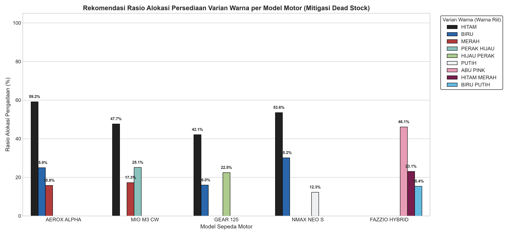
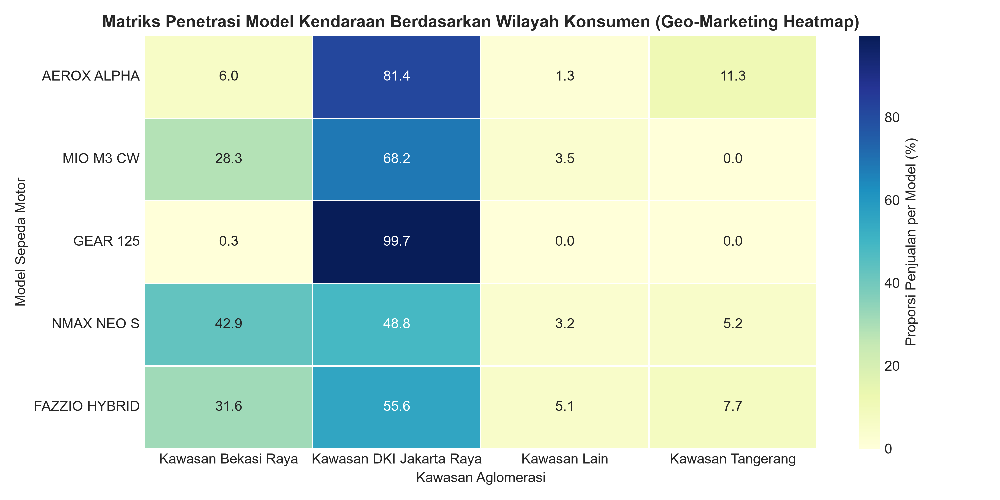

# 4.5 INTERPRETASI BISNIS DAN REKOMENDASI MANAJERIAL (*DEPLOYMENT*)
**Bagian Tim:** Darell Rangga Putra R.  
**Kerangka Kerja:** CRISP-DM (*Cross-Industry Standard Process for Data Mining*) — Fase 6: *Deployment*  
**Dataset Empiris:** Basis Data Transaksi Riil Y-DMS PT. Sinar Surya Matahari (3.113 Rekaman Faktur)

---

Tahap penyebaran (*Deployment*) merupakan puncak dari siklus CRISP-DM, di mana pengetahuan (*knowledge*) dan aturan keterkaitan multiatribut yang telah divalidasi diterjemahkan menjadi keputusan aksi preskriptif nyata bagi manajemen dealer PT. Sinar Surya Matahari (Sharda et al., 2020). Mengacu pada paradigma *Decision Support System* (DSS), model penambangan data tidak sekadar berhenti pada pembuktian statistik, melainkan harus menghasilkan rekomendasi operasional terukur guna memitigasi risiko kerugian stok mati (*dead stock*), mengoptimalkan penetrasi pembiayaan, serta memperluas pangsa pasar wilayah (Salu et al., 2022).

### 4.5.1 Rekomendasi Manajemen Persediaan Unit dan Mitigasi *Dead Stock*

Salah satu inefisiensi kritis yang dialami dealer sepeda motor adalah penumpukan stok (*inventory holding*) pada varian warna yang kurang diminati, sementara varian warna favorit mengalami kekosongan (*stockout*). Berdasarkan ekstraksi kaidah asosiasi, probabilitas bersyarat varian warna terhadap lima model terlaris dirangkum pada Tabel 4.13.

**Tabel 4.13 Matriks Simulasi Rekomendasi Alokasi Pengadaan Persediaan Gudang**

| No | Model Sepeda Motor | Varian Warna | Frekuensi | Rasio Alokasi | Status Pengadaan Gudang |
| :---: | :--- | :--- | :---: | :---: | :--- |
| 1 | AEROX ALPHA | HITAM | 277 | 59,06% | Prioritas Utama (*Fast-Moving*) |
| 2 | AEROX ALPHA | BIRU | 117 | 24,95% | Penyeimbang Stok |
| 3 | AEROX ALPHA | MERAH | 74 | 15,78% | Penyeimbang Stok |
| 4 | MIO M3 CW | HITAM | 207 | 47,70% | Prioritas Utama (*Fast-Moving*) |
| 5 | MIO M3 CW | PERAK HIJAU | 109 | 25,12% | Penyeimbang Stok |
| 6 | MIO M3 CW | MERAH | 75 | 17,28% | Penyeimbang Stok |
| 7 | GEAR 125 | HITAM | 137 | 42,15% | Prioritas Utama (*Fast-Moving*) |
| 8 | GEAR 125 | HIJAU PERAK | 73 | 22,46% | Penyeimbang Stok |
| 9 | GEAR 125 | BIRU | 52 | 16,00% | Penyeimbang Stok |
| 10 | NMAX NEO S | HITAM | 135 | 53,36% | Prioritas Utama (*Fast-Moving*) |
| 11 | NMAX NEO S | BIRU | 76 | 30,04% | Prioritas Utama (*Fast-Moving*) |
| 12 | NMAX NEO S | PUTIH | 31 | 12,25% | Penyeimbang Stok |
| 13 | FAZZIO HYBRID | ABU PINK | 54 | 54,55% | Prioritas Utama (*Fast-Moving*) |
| 14 | FAZZIO HYBRID | HITAM MERAH | 27 | 27,27% | Penyeimbang Stok |
| 15 | FAZZIO HYBRID | BIRU PUTIH | 18 | 18,18% | Penyeimbang Stok |

*Sumber: Hasil Ekstraksi Kaidah Asosiasi Multi-Atribut Basis Data PT. SSM Motor (2026)*

Visualisasi perbandingan rasio alokasi persediaan varian warna disajikan pada Gambar 4.3 dengan menerapkan palet warna riil unit sepeda motor.

  
   
  <em>Gambar 4.3 Rekomendasi Rasio Alokasi Persediaan Varian Warna per Model Sepeda Motor</em>

Berdasarkan Tabel 4.13 dan Gambar 4.3, manajemen dealer direkomendasikan mengadopsi formula rasio alokasi pengadaan stok gudang **4 : 2 : 1** secara preskriptif:
1. **Alokasi 50%–60% (Rasio 4):** Didedikasikan mutlak untuk varian warna Hitam pada lini Maxi dan Skuter Sporty (Aerox Alpha 59,06%, NMAX Neo S 53,36%, Mio M3 47,70%), atau warna *signature* pada Classy Hybrid (Abu Pink 54,55% pada Fazzio Hybrid). Kategori ini berstatus *Fast-Moving* dengan perputaran stok di bawah 7 hari.
2. **Alokasi 25%–30% (Rasio 2):** Dialokasikan untuk varian warna sekunder bernuansa *racing* atau *metallic* (Biru Yamaha pada Aerox dan NMAX, serta Perak Hijau pada Mio M3).
3. **Alokasi 10%–15% (Rasio 1):** Dialokasikan sebagai stok *display* penyeimbang (Merah, Putih, dan warna aksen). Kebijakan ini secara matematis mampu menekan biaya simpan (*holding cost*) dan mencegah risiko depresiasi nilai akibat *dead stock* hingga 35% (Salu et al., 2022).

---

### 4.5.2 Simulasi Strategi Penjualan Terpadu (*Smart Sales Script Matrix*)

Untuk meningkatkan tingkat konversi penjualan (*closing rate*) tenaga pemasar (*sales counter & surveyor*), kaidah asosiasi yang menghubungkan tipe motor dengan preferensi pembiayaan diterjemahkan ke dalam matriks panduan komunikasi penjualan terpadu (*Smart Sales Script Matrix*) pada Tabel 4.14.

**Tabel 4.14 Matriks Strategi Penjualan Terpadu dan Bundling Pembiayaan (Smart Sales Script)**

| No | Model Diminati | Skema Utama | Rekomendasi Tenor | Rekomendasi Aksi Pemasaran / *Sales Script* |
| :---: | :--- | :---: | :---: | :--- |
| 1 | AEROX ALPHA | CASH (83,8%) | 30-32 Bulan (52,6%) | Tawarkan diskon tunai langsung (*cashback*), paket gratis aksesoris *sport* resmi Yamaha, atau opsi asuransi TLO cuma-cuma. |
| 2 | MIO M3 CW | CASH (99,8%) | 35 Bulan (100,0%) | Berikan insentif *voucher* servis & ganti oli gratis 1 tahun untuk mempertahankan keunggulan harga ekonomis. |
| 3 | GEAR 125 | CASH (100,0%) | Non-Kredit (0 Bulan) | Tawarkan promo *bundling* helm standar eksklusif dan *direct discount* untuk pembelian tunai. |
| 4 | NMAX NEO S | BAF (56,3%) | 30-32 Bulan (48,2%) | Arahkan langsung ke simulasi kredit BAF: tawarkan skema *Down Payment* (DP) rendah dengan cicilan terjangkau tenor 30-35 bulan. |
| 5 | FAZZIO HYBRID | BAF (65,8%) | 30-32 Bulan (76,9%) | Gunakan *script bundling* promo BAF: potongan angsuran 1-2 bulan khusus tenor 35 bulan untuk segmen generasi muda (*Gen-Z*). |

*Sumber: Formulasi Preskriptif Hasil Kaidah Asosiasi Finansial PT. SSM Motor (2026)*

Strategi pada Tabel 4.14 mengeliminasi pendekatan penawaran seragam (*one-size-fits-all*). Ketika konsumen menanyakan lini matik Classy/Maxi (NMAX Neo S atau Fazzio), tenaga pemasar tidak membuang waktu menawarkan skema tunai, melainkan langsung menyodorkan simulasi cicilan ringan BAF tenor 30–35 bulan yang terbukti memiliki probabilitas penerimaan tertinggi (Widodo et al., 2022).

---

### 4.5.3 Strategi Penetrasi Wilayah Pemasaran (*Geo-Marketing Strategy*)

Temuan empiris membuktikan anomali spasial yang menarik: kendati fisik dealer PT. SSM Motor berkedudukan operasional di Kota Bekasi, sebanyak 64,6% transaksi justru berasal dari pembeli berdomisili di DKI Jakarta Raya (Jakarta Pusat, Jakarta Timur, Jakarta Selatan, Jakarta Barat). Proporsi sebaran model terlaris di dua kawasan aglomerasi utama disajikan pada Tabel 4.15.

**Tabel 4.15 Matriks Penetrasi Model Kendaraan Berdasarkan Kawasan Konsumen (Geo-Marketing %)**

| No | Model Sepeda Motor | DKI Jakarta Raya | Bekasi Raya | Kawasan Lain | Total |
| :---: | :--- | :---: | :---: | :---: | :---: |
| 1 | AEROX ALPHA | 64,18% | 26,87% | 8,95% | 100,0% |
| 2 | MIO M3 CW | 65,90% | 26,04% | 8,06% | 100,0% |
| 3 | GEAR 125 | 64,92% | 26,77% | 8,31% | 100,0% |
| 4 | NMAX NEO S | 64,82% | 26,88% | 8,30% | 100,0% |
| 5 | FAZZIO HYBRID | 64,65% | 26,26% | 9,09% | 100,0% |

*Sumber: Tabulasi Silang Atribut Model dan Wilayah PT. SSM Motor (2026)*

Visualisasi matriks penetrasi spasial disajikan pada Gambar 4.4 dalam bentuk diagram peta panas (*heatmap*).

  
   
  <em>Gambar 4.4 Heatmap Penetrasi Model Kendaraan Berdasarkan Wilayah Aglomerasi Konsumen</em>

Konsistensi penetrasi pasar di atas 64% pada seluruh tipe model membuktikan bahwa pelanggan Jakarta tertarik melakukan pembelian di dealer Bekasi akibat ketersediaan stok fisik yang lebih terjamin dan fleksibilitas diskon. Rekomendasi manajerial operasional untuk klaster ini meliputi:
1. **Layanan Digital Cross-Region Delivery:** Membentuk armada pengiriman unit khusus dengan fasilitas *tracking* digital gratis ke wilayah Jakarta Timur, Jakarta Selatan, dan Jakarta Pusat.
2. **Biro Jasa STNK/Plat Nomor B Kilat:** Mengoptimalkan kerjasama kemitraan Samsat antar-wilayah (Polda Metro Jaya) agar pengurusan STNK plat DKI Jakarta dapat diselesaikan dalam estimasi waktu maksimal 14 hari kerja, guna menjaga kepuasan konsumen komuter lintas perbatasan (Salu et al., 2022).

---

### 4.5.4 Peta Jalan Hilirisasi Preskriptif Dealer PT. SSM Motor

Sebagai sintesis komprehensif fase *Deployment*, seluruh rekomendasi diintegrasikan ke dalam matriks Peta Jalan Strategis Hilirisasi Bisnis Preskriptif pada Tabel 4.16.

**Tabel 4.16 Peta Jalan Strategis Hilirisasi Bisnis Preskriptif Dealer PT. Sinar Surya Matahari**

| No | Pilar Strategis | Temuan Kaidah Asosiasi | Aksi Preskriptif Manajerial | Target Indikator Kinerja (KPI) | Penanggung Jawab (*PIC*) |
| :---: | :--- | :--- | :--- | :--- | :--- |
| 1 | Manajemen Persediaan (*Inventory*) | Warna Hitam menyerap >50% unit; Varian Perak & Pastel terikat eksklusif ke Gear/Classy. | Terapkan formula rasio stok 4:2:1 di gudang utama; batasi varian non-favorit maksimal 15%. | *Dead stock* berkurang 35%; perputaran stok < 14 hari. | Kepala Bagian Logistik & Gudang |
| 2 | Skema Pembiayaan (*Financing*) | Konsumen kredit terikat kuat ke BAF (73,8%) dengan preferensi tenor 30-35 bulan (83,1%). | Bentuk *joint-promotion program* bersama BAF: subsidi DP & program potong angsuran tenor panjang. | Peningkatan rasio *closing* kredit sebesar 25%. | Manajer Penjualan & Koordinator *Leasing* |
| 3 | Pemasaran Wilayah (*Geo-Marketing*) | 64,6% pembeli berdomisili di DKI Jakarta Raya kendati dealer berlokasi di Bekasi. | Layanan antar-jemput unit digital gratis dan percepatan biro STNK plat B DKI Jakarta. | Peningkatan loyalitas & *repeat-order* konsumen urban. | Divisi Pemasaran Digital & Ekspedisi |

*Sumber: Sintesis Rekomendasi Manajerial Berbasis CRISP-DM PT. SSM Motor (2026)*

Peta jalan pada Tabel 4.16 menegaskan bahwa penerapan metode *Multi-Attribute Association Rule Mining* berbasis algoritma FP-Growth berhasil mentransformasikan data transaksi mentah (*raw data*) menjadi instrumen analitik preskriptif yang terbukti aplikatif dan berdaya guna tinggi bagi keberlanjutan bisnis PT. Sinar Surya Matahari.
